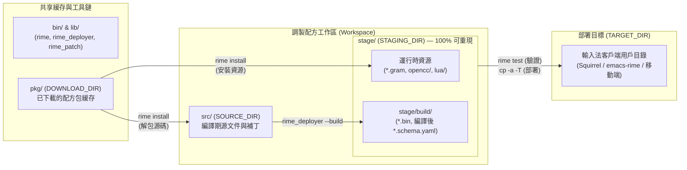

# rime-make 架構設計文檔

`rime-make` 是新一代 Rime 輸入法配方構建與部署工具，旨在結合聲明式任務執行器 `cargo-make` 與專用命令行工具鏈 `rime-cli`，取代 `/plum/`（`rime-install`）腳本，提供結構化、可重現、支持離線構建與測試的配方管理體系。

---

## 一、設計背景與核心目標

傳統 `/plum/` 腳本及客戶端內嵌部署流程存在以下痛點：
1. **源碼與產物混雜**：傳統 `librime` 將源文件、資源文件與用戶運行時數據全部混放於單一用戶目錄（`RIME_USER_DATA_DIR`），僅將編譯生成的二進制字典與合成方案緩存於 `build/` 子目錄（即 `librime` 內部所稱的 `staging_dir`）。
2. **運行期干擾風險**：當輸入法客戶端正在運行並通過內存映射（`mmap`）讀取 `build/*.bin` 時，直接在用戶目錄內重新部署容易引發數據不一致或程序崩潰。
3. **缺乏離線構建與分發能力**：移動端輸入法或輕量級客戶端不宜在設備上執行繁重的字典編譯，亟需支持在個人電腦或服務器端按用家訂閱的處方預先完成構建（「離線部署」），再將產物整體傳輸至目標設備。
4. **腳本擴展性受限**：複雜配方（如依賴其他配方包、需預先編譯語料庫或 OpenCC 詞典、按參數生成配置補丁）難以僅靠 Shell 腳本可靠維護。

爲此，`rime-make` 確立了以下設計目標：
- **離線構建與安全部署**：在隔離的工作區內完成源碼組裝、數據編譯與自動化測試，確認無誤後再一次性部署至目標環境。
- **明確區分編譯期源碼與運行時產物**：所有運行時所需文件（含二進制字典與資源文件）均在 `stage/` 目錄中完整重現，與 `src/` 中的編譯期源文件徹底解耦。
- **標準流程自動化與自定義步驟並重**：標準配方可由工具自動生成任務定義，特殊配方則可通過顯式配方文件擴展構建、安裝與補丁步驟。

---

## 二、目錄架構與職責劃分

在 `rime-make` 架構下，傳統 `librime` 中混爲一談的目錄被拆解爲**共享工具與包緩存**、**調製配方工作區**與**部署目標**三個層次：

### 1. 共享緩存與工具鏈（跨工作區複用）
- **`bin/`、`lib/`**：打包 `librime/tools` 中的核心工具（`rime_deployer`、`rime_patch` 等）與新開發的 `rime-cli` 命令行程序及插件。
- **`pkg/`（`DOWNLOAD_DIR`）**：已下載配方包的本地緩存倉庫，以配方包爲單位組織目錄結構。當用家在同一機器上維護多個前端環境（如 Squirrel 與 `emacs-rime`）或在服務器上爲多用家構建處方時，`pkg/` 可跨工作區共享，無需重複下載。

### 2. 調製配方工作區（Workspace：`src/` + `stage/`）
工作區對應單一處方與目標環境的構建實例：
- **`src/`（`SOURCE_DIR`）—— 編譯期源文件目錄**：
  - 存放由 `init-workspace` 拉取的用家個人配置源碼、由 `rime install` 從 `pkg/` 解包出的方案與詞典源碼（`*.schema.yaml`、`*.dict.yaml` 等），以及由 `rime_patch` 生成的方案補丁（`*.custom.yaml`）。
  - 此目錄中的文件僅作爲編譯輸入，運行中的輸入法客戶端不直接讀取 `src/`。
- **`stage/`（`STAGING_DIR`）—— 運行時產物目錄**：
  - 匯集輸入法客戶端運行所需的**全部可重現文件**：
    1. **運行時資源文件**（位於 `stage/` 下，如八股文語言模型 `*.gram`、`opencc/*` 轉換配置與詞典、`lua/*` 腳本等）；
    2. **編譯後二進制數據**（位於 `stage/build/` 下，由 `rime_deployer --build` 生成的 `*.table.bin`、`*.prism.bin`、`*.reverse.bin` 及合併後的 `*.schema.yaml`、`default.yaml`）。
  - > [!IMPORTANT]
    > 在 `rime-make` 中，`build/` 不再作爲一級概念存在，僅因 `librime` 運行時默認在 `<user_data_dir>/build/` 下查找二進制字典而在 `stage/` 內部保留該子目錄結構。`stage/` 內的所有文件均可由 `pkg/` 與 `src/` 重新構建生成。

### 3. 部署目標（`target/` / `TARGET_DIR`）
- 實際供輸入法客戶端加載的目標路徑：
  - **默認（`development` / 移動端離線構建）**：本地 `target/` 目錄（可直接打包傳輸至移動端應用存儲空間）。
  - **桌面端 Profile**：直接將 `TARGET_DIR` 指向對應前端的用戶數據目錄，例如：
    - `squirrel`：`${HOME}/Library/Rime`（或軟鏈接至 `~/.config/rime`）
    - `emacs-rime`：通過 `emacs --quick --batch` 動態獲取原始 `user-emacs-directory` 下的 `rime` 子目錄（如 `~/.config/emacs/rime` 或 `~/.emacs.d/rime`）
    - `ibus-rime`：`${HOME}/.config/ibus/rime`
    - `fcitx-rime`：`${HOME}/.config/fcitx/rime`
    - `weasel`：`${APPDATA}/Rime`

---

## 三、數據類型與配方構建轉換規則

通過嚴格區分編譯期源文件（`src/`）與運行時產物（`stage/`），不同類型的配方包在 `rime-make` 中遵循清晰的數據流轉規則：

| 配方數據類型 | 典型示例 | `pkg/` $\rightarrow$ `src/`（源碼準備） | `src/` $\rightarrow$ `stage/`（構建與組裝） |
| :--- | :--- | :--- | :--- |
| **純源碼配方** | `prelude`、`luna-pinyin`、`cangjie`、`lotem/rime-octagram-data`（配置） | `rime install` 解包 `*.yaml` 至 `src/`；`rime_patch` 生成 `src/*.custom.yaml` | `rime_deployer --build` 編譯生成 `stage/build/*.bin` 與 `stage/build/*.schema.yaml` |
| **預編譯資源配方** | `lotem/rime-octagram-data@hant`（含 `.gram`） | 無編譯期源碼（或僅保留元數據） | `rime install` 直接將預編譯資源文件安裝至 `stage/` |
| **自定義編譯資源配方** | 需從原始語料構建 `.gram`、或調用 `opencc_dict` 編譯 `.ocd2`、或由腳本生成 `.dict.yaml` | `rime install` 解包原始語料至 `src/`；若生成 `.dict.yaml` 則在 `build-recipe` 階段寫入 `src/` | 自定義 `build-recipe` 調用外部編譯工具將產物寫入 `stage/`（或交由 `rime_deployer` 編譯至 `stage/build/`） |

---

## 四、三層 TOML 配置模型

系統採用 `cargo-make` 的擴展機制（`extend`），將配置文件劃分爲三層：

### 1. 基礎流程定義層（[rime.toml](./rime.toml)）
- 定義四個核心目錄環境變量（`DOWNLOAD_DIR`、`SOURCE_DIR`、`STAGING_DIR`、`TARGET_DIR`）與各輸入法客戶端 Profile（`ibus-rime`、`fcitx-rime`、`weasel`、`squirrel`、`emacs-rime`）。
- 定義標準構建與部署生命周期任務鏈：
  - `tasks.init-workspace`：初始化工作區（如拉取用家個人配置倉庫至 `src/`）。
  - `tasks.update-workspace`：執行 `fill-prescription` $\rightarrow$ `recipes`，按單抓取並安裝全部配方與補丁。
  - `tasks.build`：調用 `rime_deployer --build ${SOURCE_DIR} ${SOURCE_DIR} ${STAGING_DIR}/build` 完成方案與字典的自包含編譯。
  - `tasks.test`：在 `build` 完成後，針對 `stage/` 工作區運行 `rime test` 驗證構建結果（亦作爲默認目標 `default`）。
  - `tasks.deploy`：依賴 `test`，測試通過後將 `stage/` 複製同步至 `TARGET_DIR`。
- 定義單個配方的標準處理模板 `tasks.recipe`：
  依次執行 `download-recipe`（`rime download ${RECIPE}`）$\rightarrow$ `build-recipe`（預留自定義構建鉤子）$\rightarrow$ `install-recipe`（`rime install --no-download ${RECIPE}`）。

### 2. 配方目錄與擴展配方層（[preset-recipes.toml](./preset-recipes.toml)、[grammar.toml](./grammar.toml)）
- **標準配方任務（`Rx-*`）**：
  如 `tasks.Rx-luna-pinyin`，通過 `extend = "recipe"` 繼承標準流程，並以 `env = { RECIPE = "luna-pinyin" }` 指定配方包座標（支持預設簡稱、`owner/repo` 及 `@branch` 分支語法）。此類定義格式統一，可由 `rime new recipe` 自動生成。
- **參數化功能與補丁任務**：
  如 [grammar.toml](./grammar.toml) 中的 `tasks.use-grammar`，通過 `dependencies = ["Rx-octagram-config", "Rx-octagram-data-hant"]` 自動拉取配置與模型數據依賴，並調用 `rime_patch ${SCHEMA} grammar "{__include: grammar:/hant}"` 爲調用方指定的方案寫入補丁。

### 3. 用家處方層（[user.toml](./user.toml)）
- 用家個人的入口配置文件（可按用家 GitHub 帳號命名以支持多用家管理）。
- 通過 `extend` 組合 [rime.toml](./rime.toml) 與所需配方定義文件。
- 在 `tasks.recipes` 中聲明所選用的 `Rx-*` 配方及方案自定義任務（如 `tasks.customize-luna-pinyin`，顯式聲明 `dependencies = ["Rx-luna-pinyin"]` 並設定 `SCHEMA = "luna_pinyin"` 後調用 `use-grammar` 等功能任務）。

---

## 五、後續演進與待辦事項

1. **多工作區隔離（`WORKSPACE_DIR`）**：
   - 支持按 Profile 或處方名稱隔離工作區目錄（如 `workspace/squirrel/{src,stage}` 與 `workspace/emacs-rime/{src,stage}`），同時共用頂層 `pkg/` 緩存倉庫，實現多環境並行調製互不覆蓋。
2. **包內顯式配方文件（`recipe.toml`）規範**：
   - 定義配方倉庫內置 `recipe.toml` 的元數據與生命周期鉤子規範，使 `rime install` 能自動識別源碼文件與運行時資源文件的映射關係，並在需要時委託 `cargo-make` 執行包內自定義構建腳本。
3. **`rime-cli` 核心子命令實現**：
   - `rime download`：解析配方座標（含預設別名、GitHub 倉庫、分支/標籤）並下載至 `DOWNLOAD_DIR`。
   - `rime install`：按配方類型將編譯期源碼安裝至 `SOURCE_DIR`、運行時資源安裝至 `STAGING_DIR`，並自動解析安裝配方間依賴。
   - `rime test`：加載 `STAGING_DIR` 中的構建產物，運行標準或自定義輸入法測試用例。
   - `rime_patch`：生成與手寫格式一致的 `*.custom.yaml` 補丁文件寫入 `SOURCE_DIR`。
   - `rime new recipe`：掃描現有方案代碼庫並自動生成配方定義文件。
